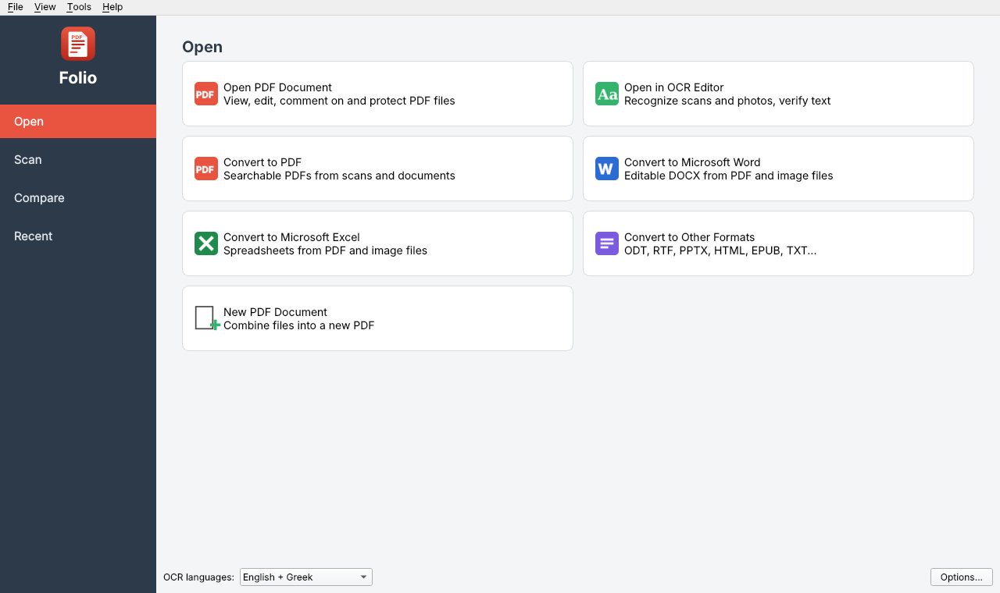
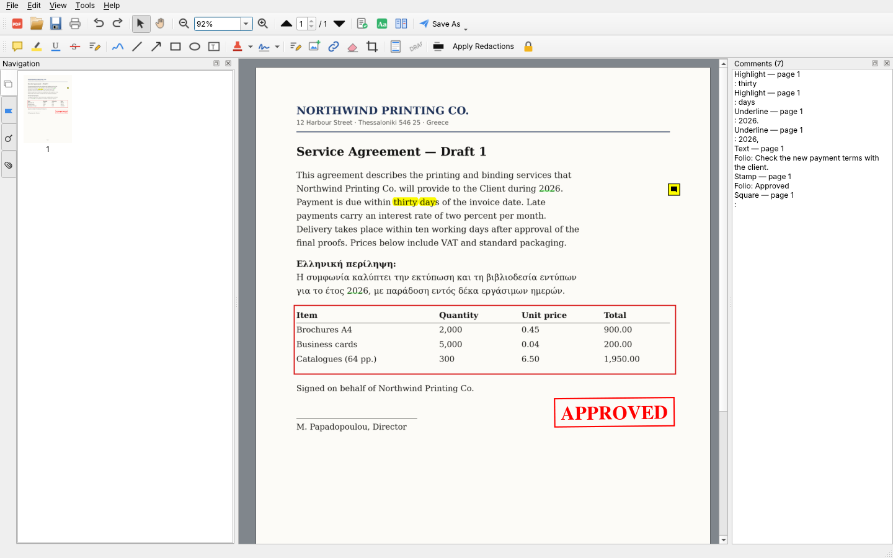
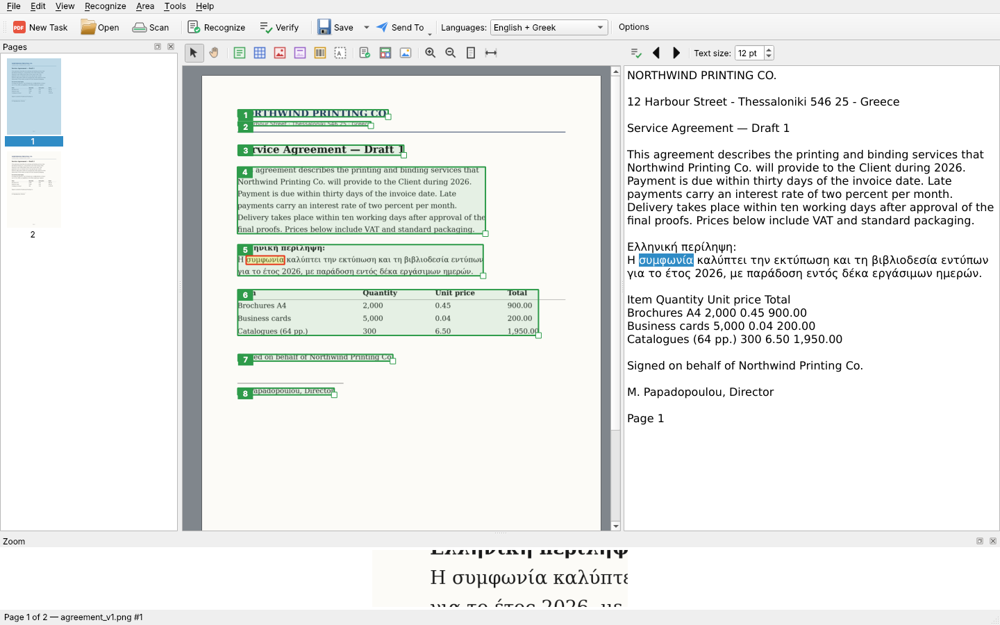
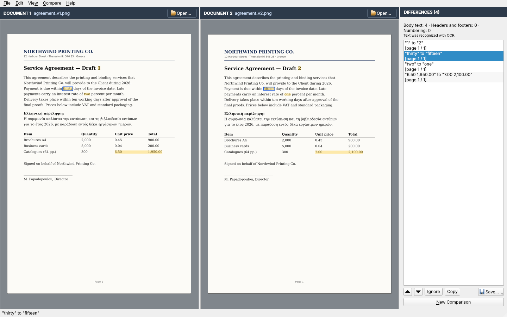
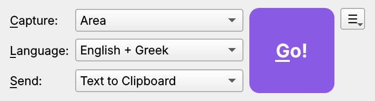

# Folio

**Folio** is an OCR and PDF suite for the Linux desktop. It turns scans, photos and screenshots into
searchable PDFs and editable documents, lets you edit and annotate PDF files, and compares two
versions of a document to show what changed.

It is built on open components: [Tesseract](https://github.com/tesseract-ocr/tesseract) for text
recognition, [MuPDF / PyMuPDF](https://pymupdf.readthedocs.io) for PDF rendering and editing, and
[Qt 6](https://www.qt.io) (PySide6) for the interface. Target platform: Ubuntu 24.04 (x86_64).



## The apps

| App | What it does | AppImage |
|---|---|---|
| **Folio Reader** | Start window for everyday tasks (open, convert, scan, compare, recent files) and a full PDF editor | `Folio-Reader-<version>-x86_64.AppImage` |
| **Folio OCR Editor** | Recognize text in scans, photos and PDFs, check it, correct it and save it in many formats | `Folio-OCR-Editor-<version>-x86_64.AppImage` |
| **Folio Compare** | Show the text differences between two versions of a document | `Folio-Compare-<version>-x86_64.AppImage` |
| **Folio Snap** | Capture part of the screen and get its text, table or image | `Folio-Snap-<version>-x86_64.AppImage` |

### Folio Reader

- **Start window** — Open PDF, open in OCR Editor, convert files to PDF, Word, Excel or other formats,
  create a new PDF from several files, scan straight to a document, recent files with search.
- **PDF editor** — notes, highlight / underline / strikethrough, ink, lines, arrows, shapes, text boxes,
  stamps, image or text signatures, edit and erase text and pictures, links, pictures, bookmarks and
  attachments, form filling, watermarks, headers and footers (page numbers, Bates numbers, dates),
  redaction, password protection (AES-256), file-size reduction, page tools (add, delete, rotate,
  reorder, crop, replace, extract), search and mark up, printing.
- **Recognize Document** adds an invisible OCR text layer, so scanned PDFs become searchable and copyable.
- **Save As** Searchable PDF, Image-only PDF, DOCX, XLSX, PPTX, ODT, HTML, EPUB, FB2, DjVu, RTF, TXT, CSV
  or page images.



### Folio OCR Editor

- Page thumbnails, image pane and editable text pane side by side, plus a zoom pane.
- Areas for text, tables, pictures, background pictures and barcodes — drawn, moved, resized and
  numbered in reading order; recognize or analyse a single area.
- Uncertain words are highlighted; a **Verify** dialog walks through them (confirm, replace,
  add to the user dictionary).
- Image tools: automatic preprocessing, deskew, rotate/flip, split facing pages, crop,
  brightness/contrast, levels, invert, photo correction, colour-mark removal, noise removal,
  black-and-white/grayscale, eraser, resolution correction.
- OCR projects (`*.folio`) keep images, areas and text together.
- **Send To** a word processor, spreadsheet, presentation, web browser, the clipboard or the PDF editor.
- **Hot Folder** watches a folder and converts every new file automatically.



### Folio Compare

- Two documents side by side with differences highlighted (deleted, added, changed) and a list of
  all differences, grouped as body text, headers/footers and numbering.
- Options for punctuation and one-letter differences; synchronised scrolling; ignore or copy a difference.
- Works with PDF, images, DOCX/ODT/RTF (through LibreOffice) and text files; scanned pages are
  recognized automatically.
- Save the result as a PDF with comments, a DOCX with tracked changes, or a comparison report.



### Folio Snap

- Capture an **area**, a **window**, the **whole screen** or the screen after a delay.
- Send the result as text, a table or an image — to the clipboard, a file, a word processor,
  a spreadsheet, the OCR Editor or an e-mail.
- Works on Wayland (through the desktop's screenshot portal) and on X11; tray icon with quick actions.
- Command line for keyboard shortcuts:
  `Folio-Snap-<version>-x86_64.AppImage --go --capture area --send "Text to Clipboard" --lang eng+ell`



## Installing and running the AppImages

```bash
chmod +x Folio-*.AppImage
./Folio-Reader-1.0.1-x86_64.AppImage                    # start window
./Folio-Reader-1.0.1-x86_64.AppImage file.pdf           # open a PDF in the editor
./Folio-OCR-Editor-1.0.1-x86_64.AppImage scan.png
./Folio-Compare-1.0.1-x86_64.AppImage old.pdf new.pdf
./Folio-Snap-1.0.1-x86_64.AppImage --go
./Folio-Reader-1.0.1-x86_64.AppImage --install-desktop  # add to the applications menu
```

If an AppImage does not start, install FUSE 2: `sudo apt install libfuse2t64`.

Each AppImage is self-contained (Python 3.12, Qt 6, PyMuPDF, Tesseract 5). Bundled OCR languages:
English, Greek, Ancient Greek, German, French, Spanish, Italian and Russian, plus page-orientation
detection. To add languages, either install them system-wide (`sudo apt install tesseract-ocr-<lang>`,
picked up automatically) or copy `*.traineddata` files into `~/.local/share/folio/tessdata`.

Optional system tools:

| Tool | Package | Used for |
|---|---|---|
| LibreOffice | `libreoffice` | opening and converting DOCX, ODT, XLSX, PPTX… |
| SANE | `sane-utils` | scanning |
| DjVuLibre | `djvulibre-bin` | opening and saving DjVu |
| xdg-utils | `xdg-utils` | e-mail and "open with" |

## Running from source

```bash
sudo apt install python3.12-venv tesseract-ocr tesseract-ocr-ell
python3.12 -m venv ~/.venvs/folio
~/.venvs/folio/bin/pip install -r requirements.txt
./run.sh reader        # or: ocr | compare | snap
```

## Building the AppImages

Requires Python 3.12, the packages from `requirements.txt`, Tesseract with its language data, and
[appimagetool](https://github.com/AppImage/appimagetool) with the
[type2 runtime](https://github.com/AppImage/type2-runtime).

```bash
~/.venvs/folio/bin/python packaging/build_appimages.py --version 1.0.1 \
    --out ../appimages --site-packages ~/.venvs/folio/lib/python3.12/site-packages \
    --appimagetool ./appimagetool --runtime ./runtime-x86_64 --extra-tessdata ./tessdata-extra
```

Output: `../appimages/v<version>/Folio-<App>-<version>-x86_64.AppImage` — each version in its own folder.

## Project layout

```
folio/core        OCR engine wrapper, image processing, documents and projects, exporters,
                  comparison engine, screen capture, scanner access, settings
folio/ui          Qt widgets (multi-page view, areas, thumbnails, language pickers), dialogs, helpers
folio/apps        reader.py (+ pdfdialogs.py), ocreditor.py, comparator.py, snap.py
folio/resources   app icons
packaging         AppImage builder
docs              feature list and screenshots
```

Settings are stored in `~/.config/folio/settings.json`. OCR projects (`*.folio`) are zip files with the
page images, areas and recognized text.

## License

Copyright (C) 2026 Demosthenes Koptsis

Folio is free software: you can redistribute it and/or modify it under the terms of the
GNU Affero General Public License as published by the Free Software Foundation, either version 3
of the License, or (at your option) any later version. See [`LICENSE`](LICENSE) for the full text.

Folio is distributed in the hope that it will be useful, but WITHOUT ANY WARRANTY; without even the
implied warranty of MERCHANTABILITY or FITNESS FOR A PARTICULAR PURPOSE.

### Third-party components

The AppImages bundle these components under their own licenses:

| Component | License |
|---|---|
| [PyMuPDF](https://github.com/pymupdf/PyMuPDF) / MuPDF | AGPL-3.0 |
| [Qt 6](https://www.qt.io) / [PySide6](https://doc.qt.io/qtforpython-6/) | LGPL-3.0 |
| [Tesseract OCR](https://github.com/tesseract-ocr/tesseract) and its language data | Apache-2.0 |
| [CPython](https://www.python.org) | PSF License |
| [Pillow](https://python-pillow.org) | MIT-CMU (HPND) |
| [NumPy](https://numpy.org) | BSD-3-Clause |
| [python-docx](https://github.com/python-openxml/python-docx), [python-pptx](https://github.com/scanny/python-pptx) | MIT |
| [openpyxl](https://foss.heptapod.net/openpyxl/openpyxl) | MIT |
| [odfpy](https://github.com/eea/odfpy) | Apache-2.0 / LGPL-2.1 / GPL-2.0 |
| [lxml](https://lxml.de) | BSD-3-Clause |
| [jeepney](https://gitlab.com/takluyver/jeepney) | MIT |
| [DejaVu fonts](https://dejavu-fonts.github.io) | Bitstream Vera / public domain |
